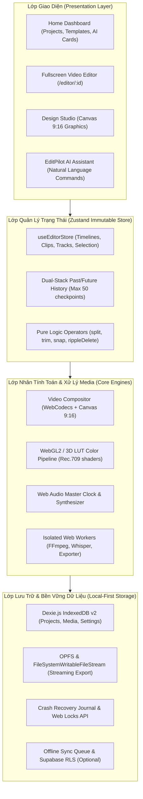
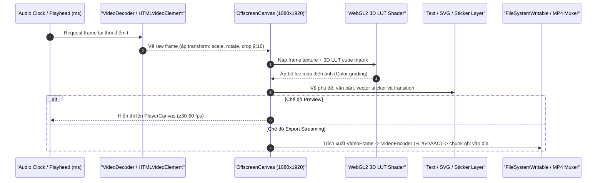
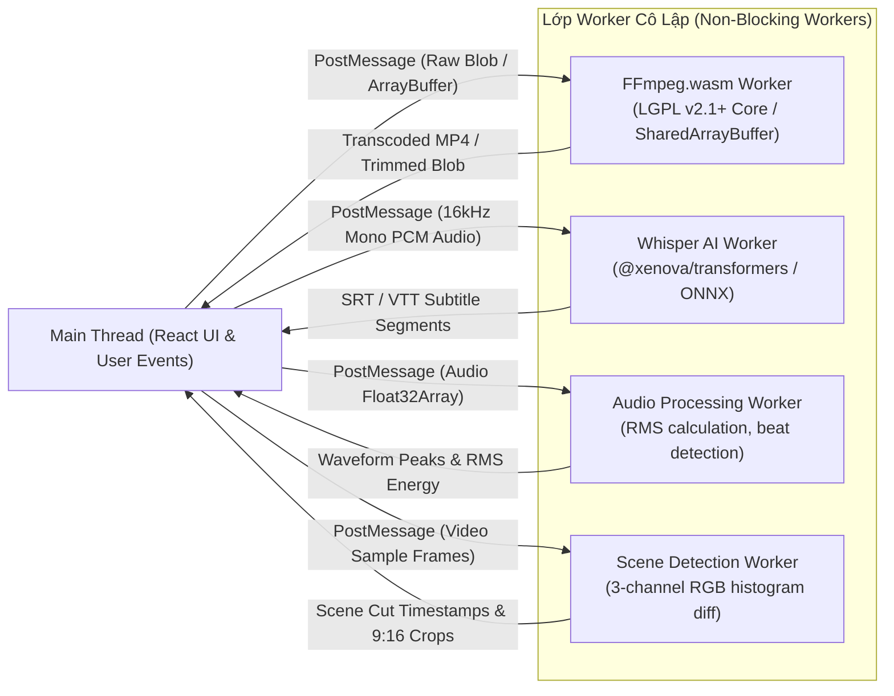
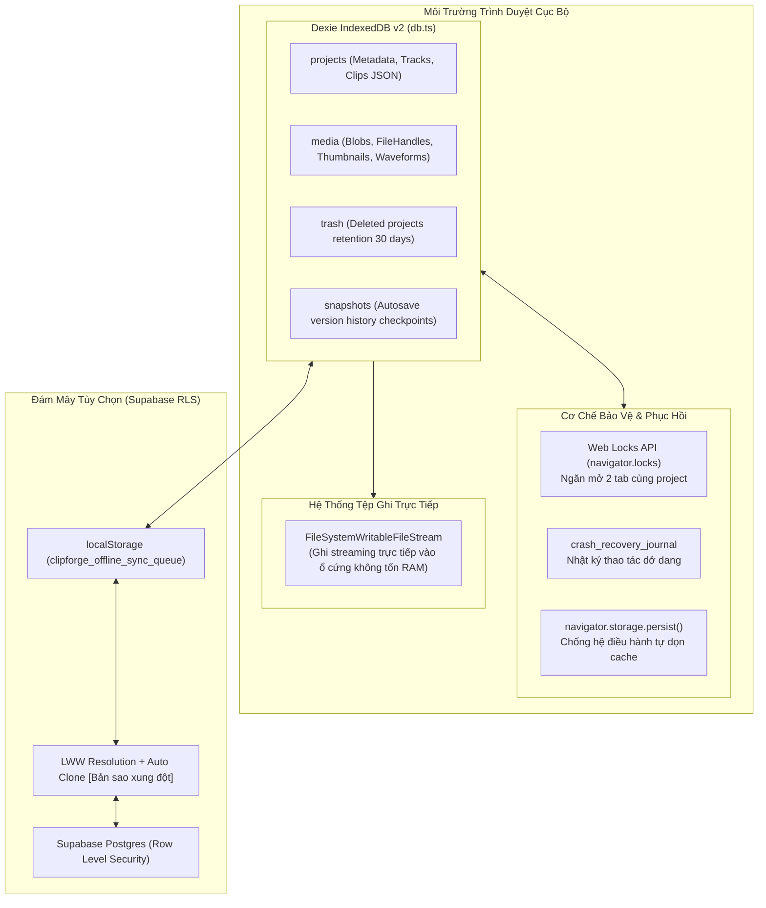
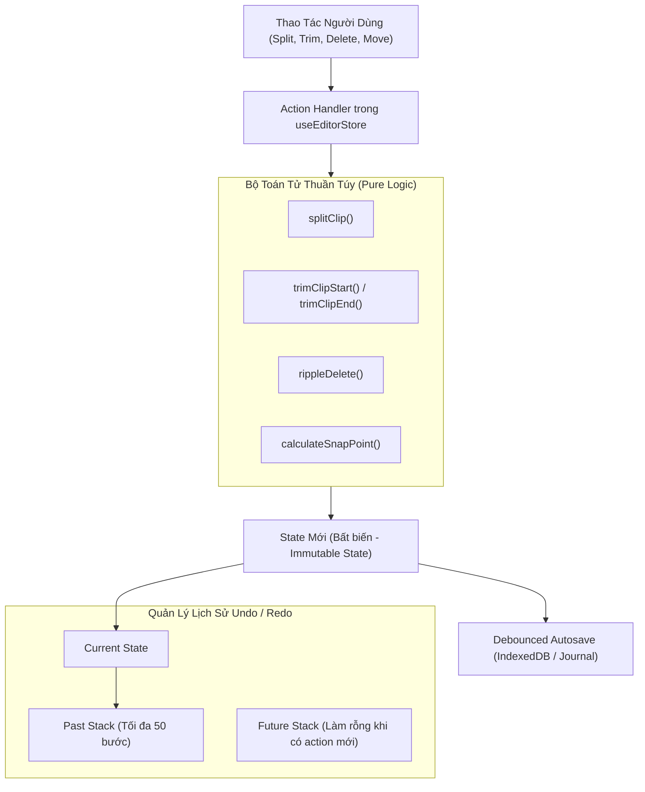

# KIẾN TRÚC HỆ THỐNG CLIPFORGE DESKTOP WEB (ARCHITECTURE)

> **Dự án**: ClipForge Desktop Web • 9:16 Vertical Video Studio  
> **Kiến trúc cốt lõi**: Local-First, Zero-Server Rendering, Client-Side Hardware Acceleration  
> **Tiêu chuẩn công nghệ**: W3C WebCodecs API, WebGL2, WebGPU, Web Audio API, Dexie IndexedDB v2, WebAssembly (FFmpeg / ONNX)

---

## 1. TỔNG QUAN KIẾN TRÚC TOÀN HỆ THỐNG (HIGH-LEVEL ARCHITECTURE)

---

## 2. SƠ ĐỒ PIPELINE VIDEO COMPOSITOR (PREVIEW & EXPORT)

Quy trình render đảm bảo nguyên lý **Preview = Export**: cùng một đường ống tính toán canvas offscreen và shader WebGL2 được sử dụng cho cả phát lại thời gian thực và xuất file thành phẩm.

---

## 3. KIẾN TRÚC WEB WORKERS ĐA NHIỆM (WORKERS ISOLATION)

Các tác vụ nặng về tính toán hoặc xử lý file lớn đều được tách biệt vào các Web Worker riêng biệt thông qua dynamic blob URL (`toBlobURL`), đảm bảo giao diện chính (Main Thread) duy trì 60fps mượt mà:

---

## 4. KIẾN TRÚC LƯU TRỮ & ĐỘ BỀN DỮ LIỆU (STORAGE & PERSISTENCE)

---

## 5. MÔ HÌNH QUẢN LÝ TRẠNG THÁI (STATE & IMMUTABILITY)

---

## 6. QUY TẮC BẢO TRÌ VÀ MỞ RỘNG (ENGINEERING PRINCIPLES)
1. **Zero Server Dependency**: Ứng dụng phải luôn chạy hoàn chỉnh ở chế độ Guest ngoại tuyến mà không yêu cầu backend, không gửi dữ liệu ra ngoài trừ khi người dùng chủ động cấu hình.
2. **Deterministic Timeline Mathematics**: Mọi toán tử biến đổi timeline phải là hàm thuần túy (pure functions) nhận `(clips, ...params)` và trả về mảng `clips` mới, có unit test tự động xác minh.
3. **Hardware-First Encoding**: Ưu tiên WebCodecs hardware encoder trước khi fallback về WebAssembly để đảm bảo tốc độ và tiết kiệm pin thiết bị.

