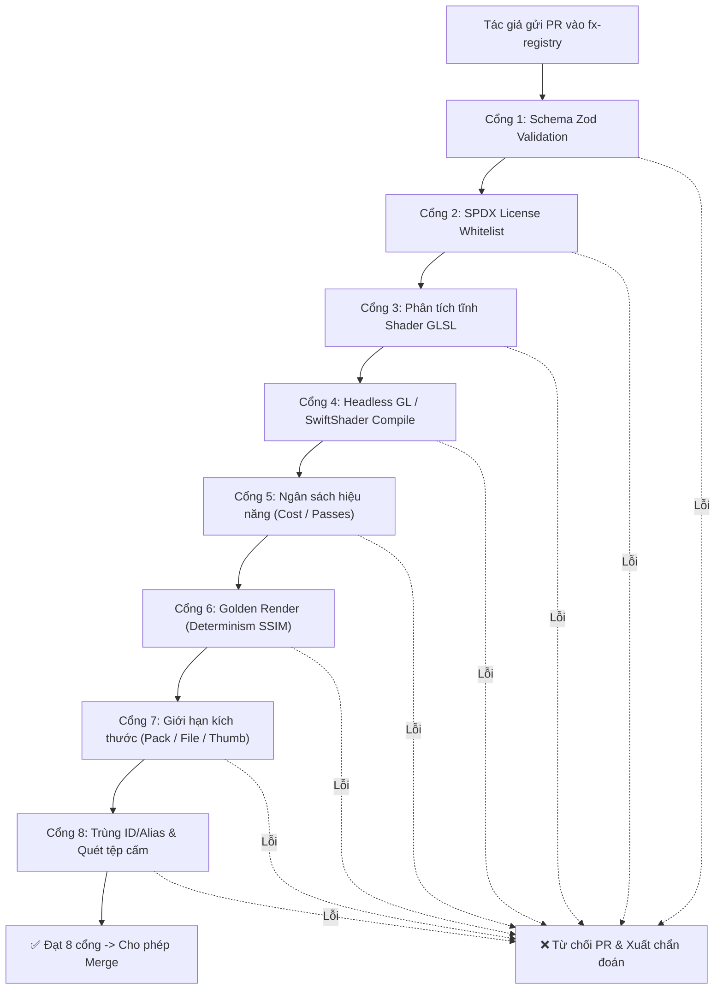

# REGISTRY_RUNBOOK.md
# Sổ Tay Vận Hành Kho Hiệu Ứng ClipForge (Registry Operator Runbook)

> **Dành cho:** Kỹ sư vận hành (Site Reliability Engineers / Registry Operators) và Quản trị viên duyệt kho (Registry Maintainers) quản lý kho tài nguyên tĩnh `fx-registry`.  
> **Cam kết SLA:** Phản hồi khiếu nại bản quyền $\le 24\text{h}$; Thu hồi khẩn cấp phiên bản lỗi (Yank) $\le 30\text{ phút}$; Rollback chỉ mục kho $\le 60\text{ giây}$.

---

## 1. Kiến Trúc Phân Phối Tĩnh (Static Distribution)

Kho tài nguyên ClipForge được triển khai dưới dạng **Hosting tĩnh (Static Hosting)** trên Cloudflare R2 / Cloudflare Pages / GitHub Pages, không dùng cơ sở dữ liệu động và không cần server API backend:

```text
https://registry.clipforge.app/
├── registry/
│   ├── index.json               # Danh mục toàn bộ hiệu ứng (Ký số Ed25519)
│   ├── index.json.br            # Bản nén Brotli (< 300KB cho 1,000 gói)
│   └── packages/                # Bản sao spec độc lập cho từng gói
│       └── <packId>.json
└── packs/
    └── <packId>/
        └── <version>/
            ├── pack.json        # Bản kê khai chi tiết phiên bản
            └── pack.capfx       # Tệp nén container ZIP chứa asset
```

### Yêu cầu Header Bắt Buộc:
Vì trình duyệt chạy ứng dụng ClipForge kích hoạt cờ cô lập nguồn chéo **COEP: `require-corp`** (để hỗ trợ đa luồng `SharedArrayBuffer` cho WebCodecs & FFmpeg), mọi phản hồi từ domain kho bắt buộc phải chứa các headers:

```http
Access-Control-Allow-Origin: *
Cross-Origin-Resource-Policy: cross-origin
Cache-Control: public, max-age=3600, stale-while-revalidate=86400
```

---

## 2. Quy Trình Kiểm Duyệt CI Bắt Buộc Cho Pull Request

Mỗi khi có Pull Request gửi vào kho `fx-registry` (thêm mới hoặc cập nhật hiệu ứng), hệ thống GitHub Actions CI bắt buộc phải chạy bộ kiểm tra **8 Cổng An Toàn**:



### Chi tiết 8 cổng kiểm duyệt:
1. **Schema Check**: Khớp chính xác Zod schema `EffectPackZod`.
2. **SPDX License**: Giấy phép phải thuộc danh sách cho phép (`MIT`, `Apache-2.0`, `CC0-1.0`, `BSD-2-Clause`, `BSD-3-Clause`, `OFL-1.1`, `ISC`, `Unlicense`, `In-House`, `Proprietary`).
3. **Phân Tích Tĩnh Shader**:
   - Cấm `#extension` lạ, cấm `#include`.
   - Cấm vòng lặp `while` và `do-while`.
   - Cận trên vòng lặp `for` $\le 32$.
   - Số lần lấy mẫu vân ảnh $\le 16$.
   - Số uniforms $\le 32$.
   - Độ dài mã nguồn GLSL $\le 16\text{ KB}$.
4. **Headless GL Compilation**: Đóng gói qua `wrapFragmentShader` và kiểm tra biên dịch trên WebGL2 context (SwiftShader).
5. **Ngân Sách Hiệu Năng**: Số passes $\le 3$, `samplesPerPixel` $\le 16$.
6. **Golden Render**: Kết xuất thử tại 5 mốc tiến trình (`0.0, 0.25, 0.5, 0.75, 1.0`). Đảm bảo hai lần chạy với cùng `uSeed` cho ra kết quả khớp nhau 100% pixel (SSIM $\ge 0.98$, PSNR $\ge 40\text{ dB}$).
7. **Giới Hạn Kích Thước**: Gói $\le 50\text{ MB}$, tệp lẻ $\le 25\text{ MB}$, ảnh thumbnail $\le 8\text{ KB}$, tỉ lệ nén $\le 100:1$.
8. **Trùng Lặp & Quét Nguồn Gốc**: Không trùng lặp `id@version` đã phát hành; không trùng alias xung đột; cấm tuyệt đối tệp thực thi (`.js`, `.wasm`, `.exe`); làm sạch mã độc trong SVG.

---

## 3. Quy Trình Xây Dựng & Ký Số Chỉ Mục (Build & Sign)

> [!CAUTION]
> **Tuyệt đối không commit khóa bí mật (Private Key) vào mã nguồn Git.**  
> Khóa ký số được quản lý qua GitHub Actions Secrets hoặc AWS/Google Cloud KMS.

### Các bước phát hành:
1. **Lấy khóa ký từ biến môi trường**:
   ```bash
   export REGISTRY_PRIVATE_KEY="f521a723d0d98d47cc6e655b7fe389b333f4f7a8fa9cc63d3c52899e9a0efe85"
   ```
2. **Biên dịch chỉ mục và ký số**:
   ```bash
   node bin/capfx.mjs build-index --packsDir public/packs --output public/registry --key $REGISTRY_PRIVATE_KEY
   ```
3. **Xác minh chữ ký số sau khi build**:
   ```bash
   node bin/capfx.mjs validate public/registry/index.json
   ```
4. **Deploy tĩnh**: Đẩy thư mục `public/` lên Cloudflare R2 / Pages CDN.

---

## 4. Giao Thức Thu Hồi Khẩn Cấp (Emergency Yank - Kill Switch)

Khi phát hiện một phiên bản hiệu ứng bị rò rỉ bộ nhớ, gây treo GPU (WebGL context lost), hoặc bị khiếu nại vi phạm bản quyền:

### Bước 1: Thực thi lệnh Yank
Người vận hành chạy lệnh CLI để thu hồi ngay lập tức:
```bash
node bin/capfx.mjs yank "com.clipforge.fx.unstable_glitch" "0.8.0" \
  --reason "Lỗi rò rỉ bộ nhớ GPU WebGL gây treo tab trình duyệt trên card tích hợp" \
  --replacement "com.clipforge.fx.rgb_shake@1.0.0" \
  --key $REGISTRY_PRIVATE_KEY
```

### Bước 2: Deploy bản cập nhật index.json
Đẩy ngay tệp `public/registry/index.json` đã cập nhật lên CDN. Thời gian hoàn thành $\le 10\text{ phút}$.

### Bước 3: Cơ chế bảo vệ phía Client
- Khi người dùng mở app hoặc duyệt kho, client tự động tải `revoked[]`.
- Phiên bản bị thu hồi sẽ ngay lập tức bị vô hiệu hóa (không cho cài đặt mới).
- Các dự án đang dùng phiên bản này sẽ **chuyển sang Ghost Reference có giải thích**, hiển thị huy hiệu `⚠️ GHOST` trên timeline và gợi ý phiên bản thay thế an toàn, **tuyệt đối không làm crash app hoặc phá vỡ cấu trúc project**.

---

## 5. Giao Thức Xoay Khóa Ký Số (Key Rotation Protocol)

Để phòng ngừa rò rỉ khóa ký, ClipForge áp dụng cơ chế xoay khóa định kỳ hằng năm với danh sách khóa xoay vòng nhúng sẵn trong ứng dụng:

```typescript
// src/utils/ed25519Verifier.ts
export const OFFICIAL_REGISTRY_KEYS = [
  {
    id: 'clipforge_ed25519_2026_primary',
    publicKeyHex: '10108fe56821894d7536e1e480176777fe92d1028b96bcdf85f1dfae1140f642',
    validFrom: '2026-01-01T00:00:00Z',
    validTo: '2027-01-01T00:00:00Z',
  },
  {
    id: 'clipforge_ed25519_2026_rotation',
    publicKeyHex: '4a2f8fe56821894d7536e1e480176777fe92d1028b96bcdf85f1dfae1140f699',
    validFrom: '2026-06-01T00:00:00Z',
    validTo: '2028-01-01T00:00:00Z',
  },
];
```

### Quy trình xoay khóa 4 bước:
1. **Tạo cặp khóa Ed25519 mới**: Sinh cặp khóa mới cho giai đoạn tiếp theo.
2. **Cập nhật danh sách khóa trong App**: Bổ sung public key mới vào mảng `OFFICIAL_REGISTRY_KEYS` trong phiên bản ứng dụng tiếp theo trước khi khóa cũ hết hạn tối thiểu 60 ngày.
3. **Giai đoạn chuyển tiếp (Grace Period)**: Cả khóa cũ và khóa mới đều được client công nhận là hợp lệ.
4. **Kích hoạt khóa mới trên CI**: Đổi `REGISTRY_PRIVATE_KEY` trong KMS/CI secrets sang khóa mới.

---

## 6. Giao Thức Rollback Chỉ Mục Trong Vòng 60 Giây

Nếu việc triển khai chỉ mục mới gây lỗi hàng loạt trên môi trường production:
1. **Lệnh khôi phục nhanh Git**:
   ```bash
   git revert HEAD --no-edit
   git push origin main
   ```
2. **Kích hoạt Instant Purge Cache trên Cloudflare CDN**:
   ```bash
   curl -X POST "https://api.cloudflare.com/client/v4/zones/$ZONE_ID/purge_cache" \
     -H "Authorization: Bearer $CF_API_TOKEN" \
     -H "Content-Type: application/json" \
     --data '{"files":["https://registry.clipforge.app/registry/index.json"]}'
   ```
3. Xác nhận tải lại `https://registry.clipforge.app/registry/index.json` và kiểm tra chữ ký số hợp lệ.

