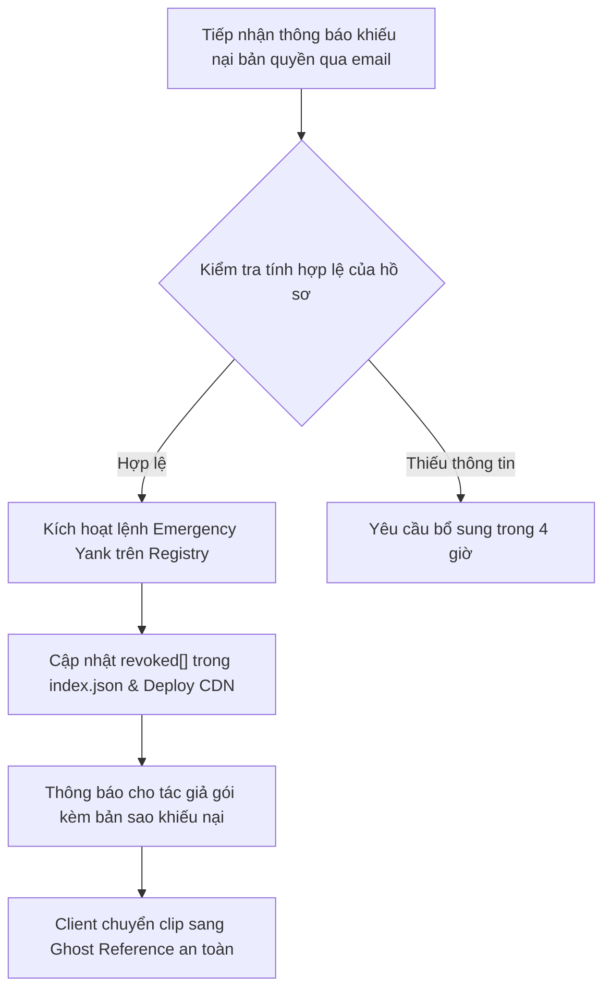

# TAKEDOWN_POLICY.md
# Quy Trình Tiếp Nhận & Xử Lý Khiếu Nại Bản Quyền (DMCA & IP Takedown Policy)

> **Cam kết:** ClipForge tôn trọng tuyệt đối quyền sở hữu trí tuệ của các tác giả, nghệ sĩ và nhà sáng tạo nội dung. Mọi tài nguyên phân phối qua Kho mở ClipForge (`fx-registry`) đều phải tuân thủ nghiêm ngặt luật bản quyền và các giấy phép mã nguồn mở được thừa nhận quốc tế.

---

## 1. Đầu Mối Tiếp Nhận Khiếu Nại Bản Quyền

Chủ sở hữu bản quyền hoặc đại diện được ủy quyền hợp pháp có thể gửi thông báo khiếu nại vi phạm bản quyền (DMCA / IP Takedown Notice) tới:

- **Email chuyên trách:** `copyright@clipforge.app` hoặc `legal@clipforge.app`
- **Thời gian cam kết phản hồi (SLA):** Trong vòng **24 giờ** kể từ khi nhận được khiếu nại hợp lệ.

---

## 2. Thông Tin Bắt Buộc Trong Đơn Khiếu Nại

Để khiếu nại được xử lý nhanh chóng trong vòng 24 giờ, đơn khiếu nại cần bao gồm các thông tin chuẩn hóa:

1. **Thông tin định danh tác phẩm gốc:**
   - Tên tác phẩm, giấy chứng nhận bản quyền, hoặc đường dẫn (URL) tới tác phẩm gốc có bản quyền (ví dụ: bộ LUT thương mại, font chữ có bản quyền, âm thanh độc quyền).
2. **Thông tin định danh tài nguyên bị khiếu nại trên Kho ClipForge:**
   - Mã gói (`packId`) và phiên bản (`version`), ví dụ: `community.vintage-looks@1.0.0`.
   - Mã hiệu ứng cụ thể (`itemId` hoặc `specId`), ví dụ: `community.vintage-looks/cinematic-lut@1.0.0`.
   - Đường dẫn liên kết trực tiếp trên Kho hoặc trong `index.json`.
3. **Bằng chứng vi phạm:**
   - Mô tả cụ thể sự tương đồng (bảng màu, hash tệp, đồ họa SVG, hoặc trích đoạn mã nguồn bị sao chép không phép).
4. **Tuyên bố thiện chí:**
   - Tuyên bố rằng bạn tin tưởng một cách thiện chí rằng việc sử dụng tài nguyên nêu trên không được chủ sở hữu bản quyền, đại diện của họ hoặc pháp luật cho phép.
5. **Thông tin liên lạc & Chữ ký:**
   - Họ tên, chức danh, tổ chức, số điện thoại, địa chỉ email, và chữ ký điện tử hoặc chữ ký tay.

---

## 3. Quy Trình Xử Lý Khẩn Cấp 4 Bước (SLA $\le 24\text{h}$)



### Bước 1: Tiếp nhận và xác minh hồ sơ ($\le 4\text{h}$)
Bộ phận pháp chế và kỹ thuật kiểm tra tính xác thực của quyền sở hữu và tệp tài nguyên bị khiếu nại trong kho `fx-registry`.

### Bước 2: Thực thi lệnh Yank khẩn cấp ($\le 30\text{ phút}$)
Kỹ sư vận hành sử dụng công cụ CLI `capfx` để đưa gói/phiên bản bị khiếu nại vào danh sách thu hồi toàn cầu:

```bash
node bin/capfx.mjs yank "community.vintage-looks" "1.0.0" \
  --reason "Thu hồi khẩn cấp theo yêu cầu bản quyền DMCA Notice #[ID]" \
  --replacement "com.clipforge.filter.teal_orange_3d@1.0.0" \
  --key $REGISTRY_PRIVATE_KEY
```

### Bước 3: Phát hành chỉ mục mới lên CDN
Ngay khi `index.json` được ký lại và đẩy lên CDN, mọi lượt tải mới của gói bị chặn hoàn toàn.

### Bước 4: Bảo vệ dự án người dùng (Cơ chế Ghost Reference)
- Ứng dụng ClipForge của người dùng sẽ **không bị crash hay mất dữ liệu dự án**.
- Clip đang sử dụng hiệu ứng bị thu hồi sẽ tự động **chuyển sang trạng thái Ghost Reference** kèm thông báo giải thích rõ lý do pháp lý.
- Hệ thống đề xuất hiệu ứng thay thế hợp pháp trong kho mà không làm gián đoạn timeline của người dùng.

---

## 4. Quy Trình Khiếu Nại Ngược (Counter-Notice)

Tác giả của gói bị thu hồi có quyền gửi thông báo khiếu nại ngược trong vòng **10 ngày làm việc** nếu cho rằng tài nguyên của mình bị gỡ bỏ do nhầm lẫn hoặc nhận diện sai:

1. Tác giả gửi email tới `copyright@clipforge.app` kèm tài liệu chứng minh quyền sở hữu hoặc giấy phép sử dụng hợp pháp (ví dụ: hóa đơn bản quyền thương mại, văn bản ủy quyền, chứng minh tác phẩm thuộc phạm vi CC0 công cộng).
2. Ban quản trị chuyển tiếp thông báo khiếu nại ngược cho bên khiếu nại ban đầu.
3. Nếu bên khiếu nại ban đầu không nộp đơn khởi kiện trong vòng 10 ngày làm việc tiếp theo, ClipForge có thể khôi phục lại gói tài nguyên sau khi xem xét kỹ lưỡng.
